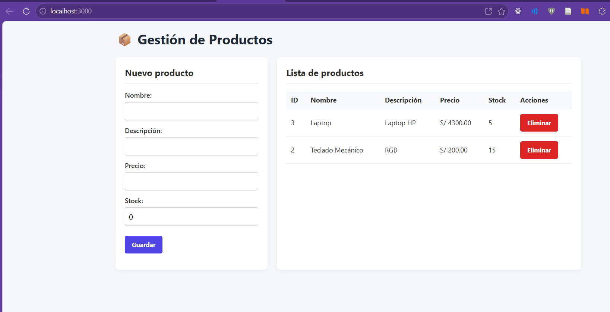
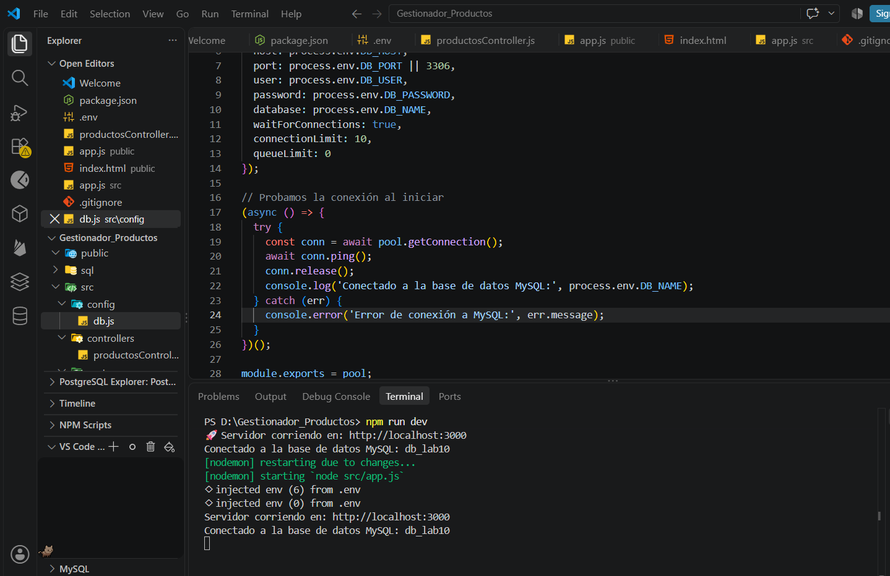
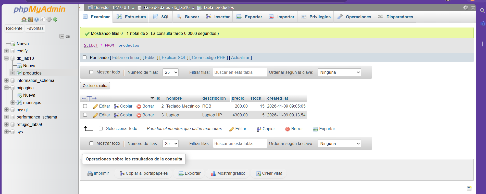
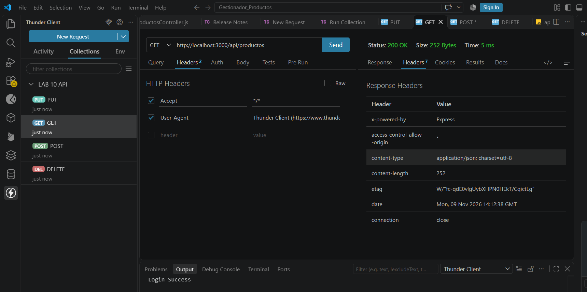
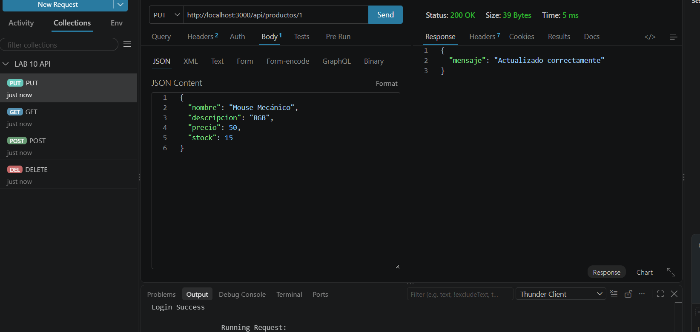
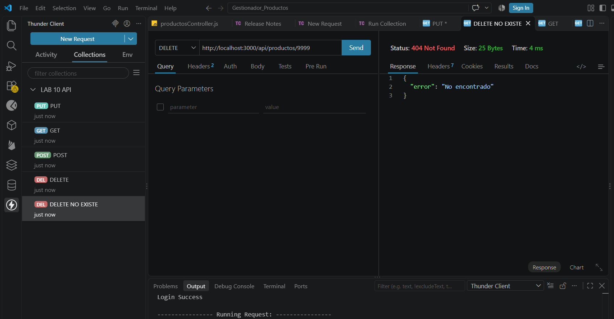
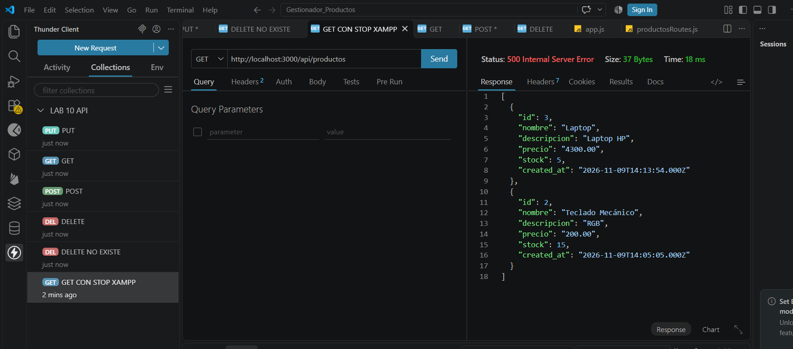

# Laboratorio 10: API RESTful con Node.js y MySQL

Este proyecto consiste en un backend desarrollado con Node.js y Express que implementa un CRUD completo para la gestión de productos, conectado a una base de datos MySQL.

## Tecnologías utilizadas
- Node.js
- Express
- MySQL (mysql2/promise)
- dotenv
- cors

## Endpoints de la API

| Método | Endpoint | Descripción | Códigos de Estado |
| :--- | :--- | :--- | :--- |
| **GET** | `/api/productos` | Lista todos los productos | 200 (OK), 500 (Error) |
| **POST** | `/api/productos` | Crea un nuevo producto | 201 (Created), 400 (Bad Request) |
| **PUT** | `/api/productos/:id` | Actualiza un producto por ID | 200 (OK), 404 (Not Found) |
| **DELETE** | `/api/productos/:id` | Elimina un producto por ID | 200 (OK), 404 (Not Found) |

## 📸 Evidencias del Ejercicio
**PROYECTO VISUAIZACIÓN**

### 1. Estructura del proyecto, código y configuración

### 2. Pruebas HTTP (Thunder Client)

**Respuestas Exitosas (200 / 201)**

**Manejo de Errores (404 / 500)**

## 🧪 Colección de Pruebas (Postman / Thunder Client)
Puedes descargar e importar la colección de pruebas para verificar los endpoints:
👉 [Descargar Colección de Postman](./POSTMAN.json)